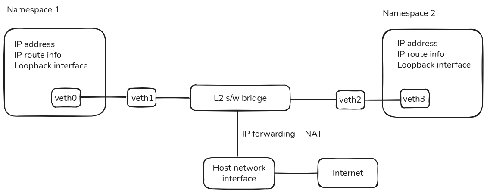

# How Container Networking is Implemented in Linux

The four building blocks:

- namespace: represents a single container's isolated network stack
- virtual interface: represents a network link to a namespace
- software bridge: an L2 software switch connecting any number namespaces
- routing and NAT: configures how the namespace accesses the internet through the host network interface

The final architecture will look like this:



## Prerequisites

sudo, iproute2, iptables, conntrack, wget, a subnet your LAN doesn't use

## Create a namespace

List all namespaces on the machine:

```bash
sudo ip netns list
```

Create 2 new namespaces

```bash
sudo ip netns add ns1
sudo ip netns add ns2
```

`ip netns exec` is too long to type every time. Going forward I will simplify it into `ip -n`. Another alternative is to start a bash shell inside the namespace with `ip netns exec ns1 bash`, same for ns2.<br>

## Create a bridge

A bridge is a link device of type `bridge`. To create one:

```bash
sudo ip link add test-bridge type bridge
```

Assign an IP address to the bridge:

```bash
sudo ip addr add 10.200.0.1/24 dev test-bridge
```

Bring up the bridge:

```bash
sudo ip link set test-bridge up
```

## Create virtual interfaces

Create 2 veth pairs. Each namespace has one virtual interface inside it, communicating with its peer in the host namespace. The virtual interfaces in the host namespace will be connected to the bridge.<br>
Create the 4 virtual interfaces

```bash
sudo ip link add veth-ns1 type veth peer name veth-ns1-br
sudo ip link add veth-ns2 type veth peer name veth-ns2-br
```

Move the two virtual interfaces into their namespaces:

```bash
sudo ip link set veth-ns1 netns ns1
sudo ip link set veth-ns2 netns ns2
```

Attach the host-side veths to the bridge:

```bash
sudo ip link set veth-ns1-br master test-bridge
sudo ip link set veth-ns2-br master test-bridge
```

Bring up the host-side veths:

```bash
sudo ip link set veth-ns1-br up
sudo ip link set veth-ns2-br up
```

Bring up the veth loopback interfaces. Assign IP addresses and bring the veths up. Then add routing information:

```bash
sudo ip -n ns1 link set lo up
sudo ip -n ns1 addr add 10.200.0.10/24 dev veth-ns1
sudo ip -n ns1 link set veth-ns1 up
sudo ip -n ns1 route add default via 10.200.0.1

sudo ip -n ns2 link set lo up
sudo ip -n ns2 addr add 10.200.0.11/24 dev veth-ns2
sudo ip -n ns2 link set veth-ns2 up
sudo ip -n ns2 route add default via 10.200.0.1
```

Ping ns1 from ns2 and vice-versa, we expect packets to be delivered.

```bash
sudo ip netns exec ns1 ping -c 3 10.200.0.11
sudo ip netns exec ns2 ping -c 3 10.200.0.10
```

Add NAT for the subnet:

```bash
sudo iptables -t nat -A POSTROUTING -s 10.200.0.0/24 ! -o test-bridge -j MASQUERADE
```

At this point I want to test connectivity to the internet but I need to do a few checks before proceeing:

- is IP forwarding enabled?
- is DNS working inside the namespaces?
- is ufw active and what policy is it configured with?

### Configure IP forwarding

The IP layer makes one of two decisions when a packet arrives at any of the network interfaces. If the destination IP address is the same as one of the host's address then it is addressed to the machine and it is delivered to the upper protocol layers. If the destination IP address doesn't match any of the host's addresses then it either drops the packet or forwards it to the next hop. IP forwarding is the setting that controls this behaviour. By default, this IP forwarding is off for security reasons, meaning packets not addressed to the host are dropped. A host with IP forwarding on can pass traffic from an untrusted source to a trusted network. Docker and K8s enable it because they need to route traffic. When IP forwarding is enabled it's recommended to accompany it with a `ufw` firewall policy that controls the traffic allowed.<br>
To check the current IP forwarding configuration:

```bash
sysctl net.ipv4.ip_forward # 0 means it is disabled
sudo sysctl -w net.ipv4.ip_forward=1 # enable it until the next reboot
```

### Configure firewall policy for forwarded packets

Firewall config and management on Ubuntu systems is done using ufw(Uncomplicated Firewall). Check if the firewall is enabled:

```bash
sudo ufw status
```

`Status: inactive` means ufw is not enabled so no further action is needed. If it's active, allow forwarded traffic from the bridge:

```bash
sudo ufw route allow in on test-bridge out on wlp1s0

ip route show default # find your interface name
```

Replace wlp1s0 with your interface name. The command translates to: "allow routed traffic arriving in from test-bridge and going out through wlp1s0".<br>
Replies come in the opposite direction, from wlp1s0 to test-bridge. These are covered by a separate built-in rule which accepts incoming forwarded packets that belong to a connection that is already being tracked.

### Configure DNS lookup inside the namespaces

DNS is the process of resolving an IP address from a name. On Linux, there are 2 ways a program can resolve a name. Most programs do this by calling glibc's `getaddrinfo()` which checks the `hosts` entry in `/etc/nsswitch.conf`. On my machine, the value of that entry is:

```
hosts:          files mdns4_minimal [NOTFOUND=return] dns myhostname
```

`files` checks the contents of /etc/hosts. `mdns4_minimal` handles resolution for .local names, which are top level domain names announced by devices on the local network without the help of DNS. `dns` sends a DNS query to the servers listed in /etc/resolv.conf. `myhostname` resolves the machine's own hostname.<br>
The other approach is by using DNS tools which skip `nsswitch` and query the servers in /etc/resolv.conf.<br>
A process running in ns1 or ns2 that needs to resolve a name reads /etc/resolv.conf, on my machine the contents are: `nameserver 127.0.0.53`. The server listening on that address is systemd-resolved.<br>
But you have to remember that a namespace isolates an entire network stack, the network interfaces(loopback included), ip addresses, routing information, etc. The host has its own network stack, so does ns1 and ns2. Therefore, when a process in ns1 makes a request on 127.0.0.53 nothing is listening on that address, because ns1's loopback interface is different from the host's, on which systemd-resolved is listening.<br>
To fix this, I will configure the DNS server for ns1 and ns2 under /etc/netns/ns1/ and /etc/netns/ns2/.

```bash
sudo mkdir -p /etc/netns/ns1
echo 'nameserver 1.1.1.1' | sudo tee /etc/netns/ns1/resolv.conf

sudo mkdir -p /etc/netns/ns2
echo 'nameserver 1.1.1.1' | sudo tee /etc/netns/ns2/resolv.conf
```

After running these commands, if you had a bash terminal created using `ip netns exec <ns> bash`, exit and start a new one for the change to take effect. Then to verify what the namespace actually sees use `sudo ip netns exec ns1 cat /etc/resolv.conf`

### Test internet access

Download a dummy file from the internet from any of the namespaces

```bash
sudo ip netns exec ns1 wget -O /dev/null https://hetzner.com
```

```bash
sudo ip netns exec ns2 wget -O /dev/null https://hetzner.com
```

Check the connection tracking stats for the namespaces and NAT

```bash
bridge fdb show dev test-bridge # view the table used by the bridge to earn MAC addresses of the veths

sudo conntrack -L -s 10.200.0.0/24
sudo iptables -t nat -L POSTROUTING -n -v

tcpdump -i test-bridge -n # watch packet flow through the bridge
```

## Cleanup

```bash
sudo ip netns del ns1 && sudo ip netns del ns2   # remove the namespaces and veths
sudo ip link del test-bridge # remove the bridge
sudo iptables -t nat -D POSTROUTING -s 10.200.0.0/24 ! -o test-bridge -j MASQUERADE # remove the NAT rule
sudo ufw route delete allow in on test-bridge out on wlp1s0 # remove the firewall rule, only if you added the rule
sudo rm -rf /etc/netns/ns1 /etc/netns/ns2 # remove the namespace DNS files
sudo sysctl -w net.ipv4.ip_forward=0 # disable IP forwarding
```
